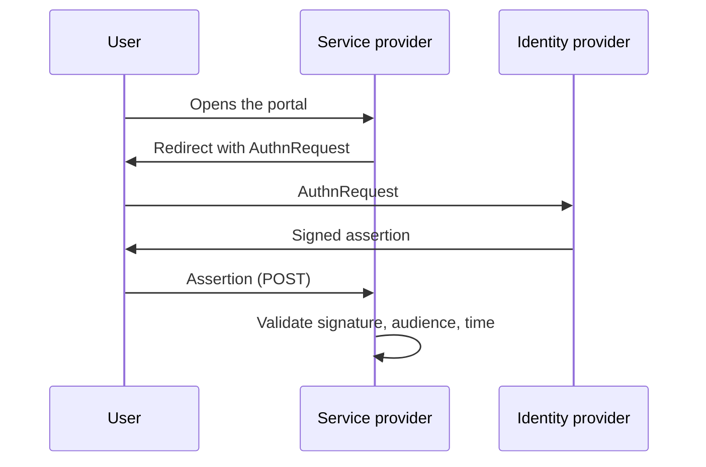

# Diagram types

Pick by the question the reader has. If none fits, it is probably a table or a list.

| The reader asks | Diagram | Mermaid | Excalidraw |
|---|---|---|---|
| How does it flow? What decides each path? | Flowchart | `flowchart LR` / `flowchart TB` | yes (spec with `diamond` for decisions) |
| Who talks to whom, in which order? | Sequence | `sequenceDiagram` | no — use Mermaid |
| When did each thing happen? | Timeline | `timeline` | no — use Mermaid |
| Which states can it be in, and what moves it? | State | `stateDiagram-v2` | yes (simple) |
| How is the topic organized? | Mind map / concept map | `mindmap` or `flowchart` | yes |
| How are the entities related? | Entity-relationship | `erDiagram` | no — use Mermaid |
| What happens when, for how long? | Gantt | `gantt` | no — use Mermaid |
| How do options compare on two criteria? | Quadrant | `quadrantChart` | no — use Mermaid |
| How are the parts of a system connected? | Architecture sketch | `flowchart` with subgraphs | yes (best for free arrangement) |

## Mermaid rules

Moki draws Mermaid in strict mode without HTML labels. Write:

- One diagram per block, the type on the first line, `LR` for flows that read left to right and `TB` for hierarchies.
- Short ids (`A`, `idp`) and labels in brackets: `idp[Identity provider]`; quote labels with special characters: `A["Token (JWT)"]`.
- Decisions as `{Question?}`, edge labels as `A -->|yes| B`.
- At most 15 nodes; group with `subgraph Name ... end` when it helps.
- No `click`, no links, no HTML (`<br>` included), no styling beyond `classDef` with a few classes.

Example:

````markdown
Figure 1 — SAML login, service-provider initiated (F1, F2).


````
