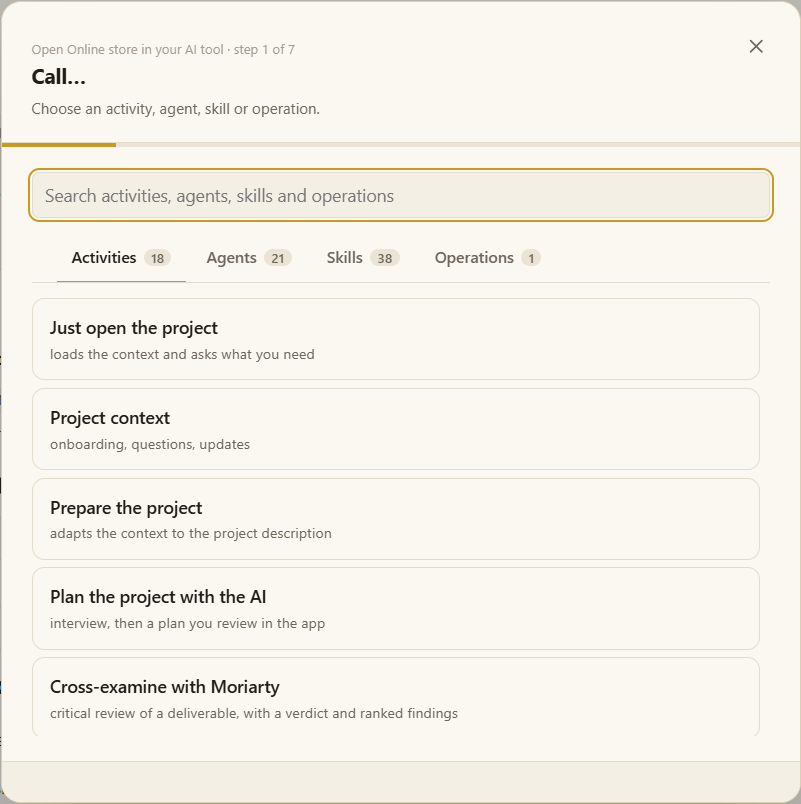

# Calling activities, agents and skills

**Call…** is how you ask the AI for something in a project. It is in the project panel, on the ▶ of the icon rail, and on **Ctrl+Shift+K** (macOS: Cmd+Shift+K).

## What you can call

| Tab | What it is | Example |
|---|---|---|
| **Activities** | A ready-made request: what to ask, of which skill or agent, with which files. | *Review user stories* |
| **Agents** | A role with its own instructions, to work with or to talk through an idea. | *sherlock* — investigates a subject |
| **Skills** | A procedure the AI follows step by step. | *test-design* |
| **Operations** | Several agents linked by arrows, each in its own terminal. | A review that goes to the team and comes back |

The list opens on **Activities** (or on the kind of the project's default). The search looks in every tab and each tab shows how many it found. The project's **defaults** come first, marked *Default*; your favorites (☆) next.

## Step by step

1. **Choose** what to call.
2. **Files** — pick the inbox files the AI should use (some activities require at least one).
3. **Shared context** — when tags share files from other projects, uncheck what this request should not use.
4. **Who does it** — optionally, an agent for a skill (or *let the skill decide*).
5. **Anything else** — a note in your words (*focus on permissions*) and the language the AI talks to you in.
6. **Where** — **This terminal** pastes the request at the cursor of the AI terminal you are in, without sending it; **New terminal** opens one.
7. **Which AI** — your default comes chosen; another choice applies only to this request.
8. **Review** and open.

An **operation** always opens its own start form instead, because each of its steps runs in its own terminal.

> [!TIP]
> **To talk through an idea**, choose an agent and write the subject as the note. No run starts unless the agent's procedure or your request calls for one.

## The activities that come with Moki

| Activity | What you get |
|---|---|
| **Review user stories** | Ambiguities, gaps and an interview, then a review matrix and a final definitions report. |
| **Review an MF from the tracker** | The same review, reading the item from Azure DevOps or Jira by its number or URL. |
| **Design tests** | Scenario mapping, then — after your OK — the test cases. |
| **Review, then design tests** | Both, with your approval in between. |
| **Failure pre-analysis** | From your description and the log: where it probably fails, and a direction for the developers. |
| **Build test evidence** | From the work item and the recordings, an evidence spreadsheet and Word document. |
| **Register items with Lestrade** | Bugs, tasks, impediments or any item type of Azure DevOps or Jira, from your material, after you approve the preview. |
| **Investigate with Sherlock** | Deep research with references you can check, delivered as a dossier. |
| **Cross-examine with Moriarty** | A critical review of a deliverable, with ranked findings and a verdict. |
| **Write a document with Watson** | Any document, organized, designed and checked, with diagrams. |
| **Validate an API with Sentinela** | Contracts, coverage and permissions, and an approved run with evidence. |
| **Design a solution with Inventor** | Problem, requirements, alternatives, architecture and a delivery plan. |
| **Model data with Cartógrafo** | Entities, relationships, dictionaries and database structures. |
| **Prototype an interface with Artesão** | A working interface prototype, reviewed in the browser. |

The **Skills and agents** card of the project panel is a shortcut: its ▶ asks the AI to use that skill or agent, in the AI terminal in focus or a new one.

You can write **your own activities** in **Settings › Activities**. More: [Activities](activities.md) · [QA skills and agents](qa-skills.md) · [Agents and operations](agents.md).

## What happens after

The AI follows the skill's procedure and **stops at its approval points** — a test plan, a bug before it is published — and waits for you in the terminal. Questions and definitions are answered in the conversation; documents land in **Execution files** and open next to the terminal. See [Runs and deliverables](runs.md).
