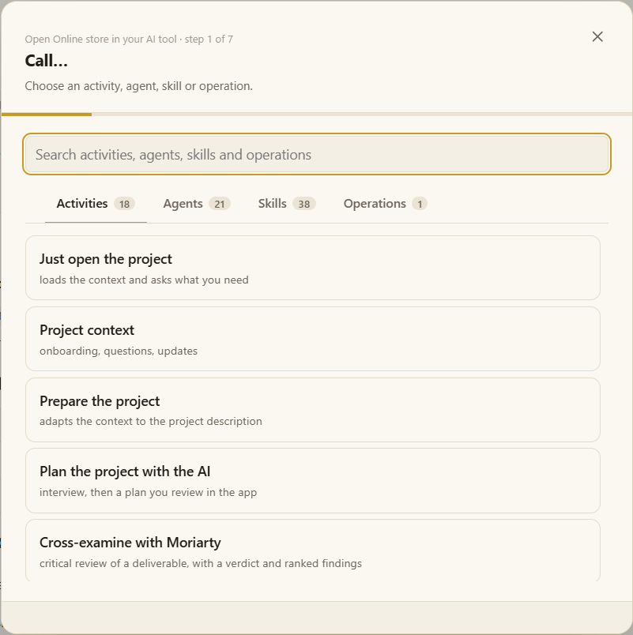

# Getting started

From nothing to your first request to the AI, in about five minutes.

## 1. Install Moki

### Windows

1. Download [Moki.Setup.0.5.7.exe](https://github.com/Orsi88/moki/releases/download/v0.5.7/Moki.Setup.0.5.7.exe) (or the latest file on [Releases](https://github.com/Orsi88/moki/releases)).
2. If Windows says it protected your PC, choose **More info → Run anyway**. The installer is not digitally signed yet.
3. Finish. A **Moki** shortcut appears on the desktop and in the Start menu.

The first launch creates **Documents\Moki**: the app files and your `workspace/`, where projects live. A newer installer refreshes the app files and never touches `workspace/` and `workspaces/`; uninstalling keeps them too.

### macOS and Linux

Run Moki from the source — see [From the source](#from-the-source) below.

### Your AI tool

Moki works with the AI you already use. Install at least one: [Claude Code](https://code.claude.com/docs/en/setup), [Codex](https://github.com/openai/codex), [Gemini CLI](https://github.com/google-gemini/gemini-cli), Cursor, or simply a web chat. Moki finds what is installed in **Settings › My AIs**, and can install a missing terminal AI for you.

> [!NOTE]
> The built-in activities that produce Excel, Word and PDF files need [Node.js 22.18+](https://nodejs.org) (LTS). The app itself opens without it.

## 2. Choose a workspace

Open Moki. The first screen lists your **workspaces** — like vaults in Obsidian. The `workspace/` you already have is the first one. In the corner you choose **English or Portuguese** and a **light or dark** theme.

<details>
<summary>More about workspaces</summary>

A workspace is a folder with its own projects, tags and settings — for example one per client or company. On the first screen you can:

- open a workspace from the list (the last one opened is marked);
- **create a new workspace** — by default in `workspaces/<name>/` inside the Moki folder, or in a folder you choose;
- **open a folder as a workspace** — a folder you already have; Moki adds a `projects/` folder inside it;
- rename one, or remove it from the list (its folder stays on the computer).

Switch workspaces at the bottom of the project list, or go back to the list with *Manage workspaces…*. Projects of one workspace never see another one.

</details>

## 3. Create your first project

Press **+** next to the project list and type a name — say *Online store* — then **Enter**. The project opens right away with its standard folders:

| Folder | What goes there |
|---|---|
| **Context** | What is confirmed about the system. Starts empty; it fills as you confirm definitions. |
| **Inbox** | The files you hand to the AI. |
| **Execution files** | What each piece of work delivered. |
| **Notes** | Your notes on the project. |
| **Temporary** | Scratch files; anything older than 7 days goes to the trash. |

> [!TIP]
> Already have the system's code or documents in a folder? **Open a project** and pick that folder: Moki links it and shows it at the top of the tree, live — nothing is copied.

## 4. Hand over a file

Drag the user story, log, spreadsheet or PDF you are working on onto the window. It is copied into **Inbox** (up to 40 files, 200 MB each). Click it to open it: Markdown opens in the editor, PDFs and images in their viewer, Word and Excel as a preview.

## 5. Call the AI

Press **Call…** in the project panel on the right (or **Ctrl+Shift+K**).

1. Choose what you want — for example **Review user stories** in *Activities*, or the agent **sherlock** in *Agents*.
2. Pick the inbox files it should use.
3. Add a note if you want (*focus on coupons*), choose **New terminal**, and your AI.

The AI opens in a terminal tab inside Moki with the request ready, follows the skill's procedure and stops whenever it needs your decision. What it delivers shows up in **Execution files** and opens next to its terminal.



## What now?

- 👀 [A tour of the screen](tour.md) — every part of the window, explained.
- 🧠 [Projects and workspaces](projects.md) — context, tags and sharing.
- 📞 [Calling activities, agents and skills](call.md) — everything **Call…** can do.

---

## From the source

Use this to run Moki on macOS or Linux, or to change the app. Windows users who installed the `.exe` can skip it.

You need Git and Node.js 22.18 or newer.

```bash
git clone https://github.com/Orsi88/moki.git
cd moki
npm run setup
npm run qa
```

`npm run setup` installs the tools, builds the app, creates `workspace/` and turns on the check that blocks commits of project data or secrets. Run it again after `git pull`.

| Command | What it does |
|---|---|
| `npm run qa` | Open the app. `npm link` once, and `qa` works from any folder. |
| `qa --terminal` | The same preparation in a terminal menu, if you prefer that to the window (in English; any project id works). |
| `npm run new-project -- <id> "<Name>" [--blank]` | Create a project folder. `--blank` leaves the QA context files out. |
| `npm run dist:win` / `dist:mac` / `dist:linux` | Build an installer on that system. Output in `release/`. |
| `npm run vscode:package` | Build the VS Code extension (`release/moki-<version>.vsix`). See [Moki in the IDE](ide.md). |
| `npm run check` and `npm test` | Validate the repository and run its tests. |

<details>
<summary>Ubuntu or WSL: "Unknown file extension .ts"</summary>

Some Ubuntu-packaged Node.js builds lack native TypeScript support, even at a compatible version (seen with Node.js v22.22.1 at `/usr/bin/node`):

```text
TypeError [ERR_UNKNOWN_FILE_EXTENSION]: Unknown file extension ".ts"
```

Install the official Node.js through [NVM](https://github.com/nvm-sh/nvm):

```bash
nvm install 22
nvm use 22
nvm alias default 22
node -p "process.features.typescript"   # should print: strip
npm run qa
```

Updating Ubuntu or checking the Node.js version alone may not fix it: the distribution and its build configuration matter.

</details>
