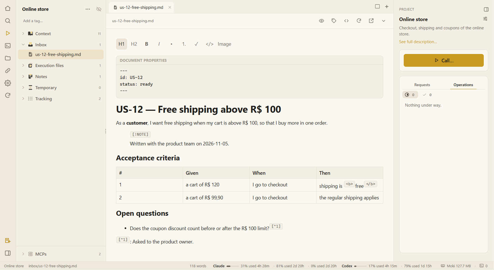

# 🐾 Moki

**Your local workspace for AI-assisted work.**

Moki keeps each project — its context, files, notes and deliverables — in a folder on your machine, and opens Claude Code, Codex, Gemini, Cursor or a web chat with the request already written. You choose the work; Moki organizes the project, gives the AI the right material and keeps the result where you can continue with it.

Moki is not an AI and it is not a cloud service. It is the local project space, document workspace and orchestration layer around the AI tools you already use.

---

## 🚀 Start in 5 minutes

1. **[Install Moki](getting-started.md)** — one installer on Windows; macOS and Linux from the source.
2. **Create a project** — give it a name, open an existing folder or start with a blank project.
3. **Add material** — drop files into the inbox, write a note or confirm project context.
4. **Press Call…** — choose an activity, agent, skill or operation and the AI opens with everything ready.

New here? Read **[What is Moki](what-is-moki.md)** and take the **[tour of the screen](tour.md)**.

---

## 🧭 What do you want to do?

| | I want to… | Go to |
|---|---|---|
| 🗂️ | Organize projects, context and linked folders | [Projects and workspaces](projects.md) |
| 📝 | Think, draft, summarize or research in a note | [Notes and quick assistants](notes.md) |
| 🤖 | Start reusable requests with an AI tool | [Calling activities, agents and skills](call.md) |
| 🔗 | Chain several agents into an operation | [Agents and operations](agents.md) |
| 📄 | Read and edit documents, PDFs and HTML | [Files and the editor](files-and-editor.md) |
| 🖍️ | Review passages, pages or regions with comments | [Files and the editor](files-and-editor.md) |
| ◇ | Open, create and review diagrams and drawings | [Files and the editor](files-and-editor.md) |
| 🔔 | Schedule checks and review notifications | [Routines and notifications](routines.md) |
| 🔌 | Give the AI browsers, trackers or other tools | [MCP servers](mcp-servers.md) |
| 🖥️ | Use the project from VS Code or Cursor | [Moki in the IDE](ide.md) |
| 🧪 | Use the built-in quality workflows | [QA skills and agents](qa-skills.md) |
| 🧩 | Add your own skills, agents and activities | [Activities](activities.md) |

Quality workflows are one part of Moki. The same project, notes, documents, integrations and AI orchestration can support research, documentation, engineering, interfaces, APIs, data and other work.

---

## 👀 A look inside

*A project: its folders on the left, a document open in the editor and the project panel with **Call…** on the right.*

---

## ❤️ Built with open source

Moki stands on the shoulders of free and open-source projects. **Thank you** to every person who builds and maintains them.

### 🏗️ Frameworks

| Framework | What it does in Moki | License |
|---|---|---|
| [Electron](https://www.electronjs.org) | The desktop app itself, on Windows, macOS and Linux | MIT |
| [React](https://react.dev) | Every screen of the app | MIT |
| [TipTap](https://tiptap.dev) | The Markdown editor of documents and notes | MIT |
| [ProseMirror](https://prosemirror.net) | The editing engine under TipTap | MIT |
| [Playwright](https://playwright.dev) | The automated tests that click through the app — and take this wiki's screenshots | Apache-2.0 |

### 🧰 Other open-source tools

| Tool | What it does in Moki | License |
|---|---|---|
| [Node.js](https://nodejs.org) | Moki's scripts and the app's engine | MIT |
| [TypeScript](https://www.typescriptlang.org) | The language Moki is written in, and its type checks | Apache-2.0 |
| [Vite](https://vite.dev) and [@vitejs/plugin-react](https://github.com/vitejs/vite-plugin-react) | Building the app's screens | MIT |
| [esbuild](https://esbuild.github.io) | Building the app's main process and the IDE extension | MIT |
| [xterm.js](https://xtermjs.org) and [@xterm/addon-fit](https://github.com/xtermjs/xterm.js) | Drawing the terminals where the AI tools run | MIT |
| [node-pty](https://github.com/microsoft/node-pty) | A real shell process behind each terminal | MIT |
| [PDF.js](https://mozilla.github.io/pdf.js/) | Showing PDFs with selectable text | Apache-2.0 |
| [pdf-lib](https://pdf-lib.js.org) | Writing highlights, comments and page edits into PDFs | MIT |
| [pptxtojson](https://github.com/pipipi-pikachu/pptxtojson) | Reading PowerPoint presentations for the slide viewer | MIT |
| [Mermaid](https://mermaid.js.org) | Diagrams drawn inside documents | MIT |
| [Excalidraw](https://excalidraw.com) | Hand-drawn style drawings you can edit | MIT |
| [marked](https://marked.js.org) | Reading Markdown for the editor | MIT |
| [electron-builder](https://www.electron.build) | The installers | MIT |
| [vsce](https://github.com/microsoft/vscode-vsce) | Packaging the VS Code extension | MIT |
| [DefinitelyTyped](https://github.com/DefinitelyTyped/DefinitelyTyped) | The types used while building | MIT |

The full list, with what each one does and where its license is: **[Credits and licenses](credits.md)**.

---

## 🗺️ Find your way

- **Start here** — [What is Moki](what-is-moki.md) · [Getting started](getting-started.md) · [A tour of the screen](tour.md)
- **Everyday work** — [Projects and workspaces](projects.md) · [Files and the editor](files-and-editor.md) · [Notes and quick assistants](notes.md) · [AI terminals](ai-terminals.md) · [Runs and deliverables](runs.md) · [Settings](settings.md)
- **AI work and extensions** — [Calling activities, agents and skills](call.md) · [Activities](activities.md) · [Agents and operations](agents.md) · [Operation recipes](operation-recipes.md) · [Engineering specialists](engineering-specialists.md)
- **Integrations** — [MCP servers](mcp-servers.md) · [Azure DevOps and Jira](trackers.md) · [Moki in the IDE](ide.md) · [ArtCraft apps](artcraft.md) · [Routines and notifications](routines.md)
- **Specialized workflows** — [QA skills and agents](qa-skills.md)
- **Help** — [Troubleshooting](troubleshooting.md) · [Privacy and isolation](privacy-and-isolation.md)

Something unclear or missing? [Open an issue](https://github.com/Orsi88/moki/issues) — the documentation is part of the product.
