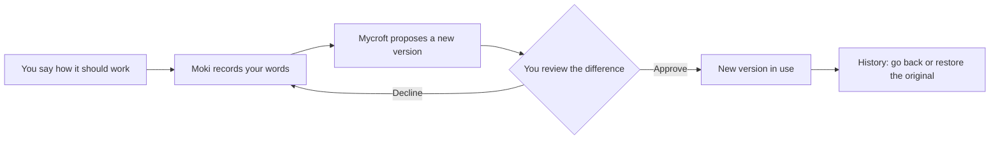

# Mycroft: teach Moki how you work

Mycroft is the agent that makes Moki fit you. When you say how an agent, skill or activity should work next time ("number the test cases TC-001", "always ask the environment first"), Moki keeps what you said. Mycroft turns it into a small change and leaves it waiting for you. Nothing changes until you approve it, and every change can be undone.

## How it works

*From what you said to a version in use: only your click changes what Moki uses.*

- **Each approved change is a new version** of the item. The previous version is not deleted; it stays in the item's history, out of the lists.
- **Moki's own files never change.** For a built-in agent, skill or activity, your version lives in your workspace and is used instead of Moki's. It survives Moki's updates.
- **Restore the original** makes Moki use its own version again; your versions stay in the history.
- **Only you approve.** No AI can apply a version, Mycroft included. Approving, declining, going back and restoring happen only in the app.

## Teach something

There are two ways:

1. **In a conversation.** While you work with any agent, say it: *"next time, put the expected result in its own column"*. The AI records your words for that item through Moki's MCP server (`moki_record_learning`). If it only applies to the current project, say so; that learning stays in the project.
2. **On the item's page.** Open **Settings › Agents**, **Skills** or **Activities**, open the item, and write in **Evolution › Teach this item something**.

## Ask Mycroft for a proposal

Start Mycroft like any agent (it is enabled in every project) and ask: *"review what I taught"*. Mycroft:

1. lists the open learnings, item by item;
2. asks you when two of them conflict (for example "short steps" and "detailed steps"), and does not choose for you;
3. writes the smallest change that does what you asked, keeping the item's headings, approval points and rules;
4. leaves it as a proposal and tells you where to approve it.

Moki checks every proposal before it is kept: a skill keeps its required sections and name, an agent keeps its name, category and access level, an activity stays valid. A proposal that breaks a rule is refused, and Mycroft fixes it or reports it.

## Approve, decline, go back

A waiting proposal shows in the notification bell (**Mycroft has 1 improvement waiting for you**) and on the item's page, under **Evolution**:

| On the item's page | What it does |
|---|---|
| **Approve** | The proposal becomes the next version and is used from the next request |
| **Decline** | The proposal is dropped; your learnings stay open |
| **View the difference** | What a version changed, line by line (removed in red, added in green) |
| **Go back to this version** | After you confirm, that version's text is used again, as a new entry in the history |
| **Restore the original** | After you confirm, Moki's own text (or, for your own item, its first text) is used again |
| **Compare with the original** | The version in use next to the original |

When Moki brings a newer version of an item you changed, the page says so. Ask Mycroft to carry your changes over to the new version; it proposes them again on top of Moki's new text.

## Good to know

- Learnings for the whole workspace are kept in `workspace/library/evolution/`; a project's own learnings in `workspace/projects/<project-id>/learnings.jsonl`. Mycroft reads only the workspace's and the current project's.
- Claude Code's native subagents (`.claude/agents/`) are generated from Moki's original files. Requests started from Moki (app, IDE panel, operations) always use the version in use.
- Creating a new agent, skill or activity is the Configurador's job; Mycroft only evolves existing ones.
