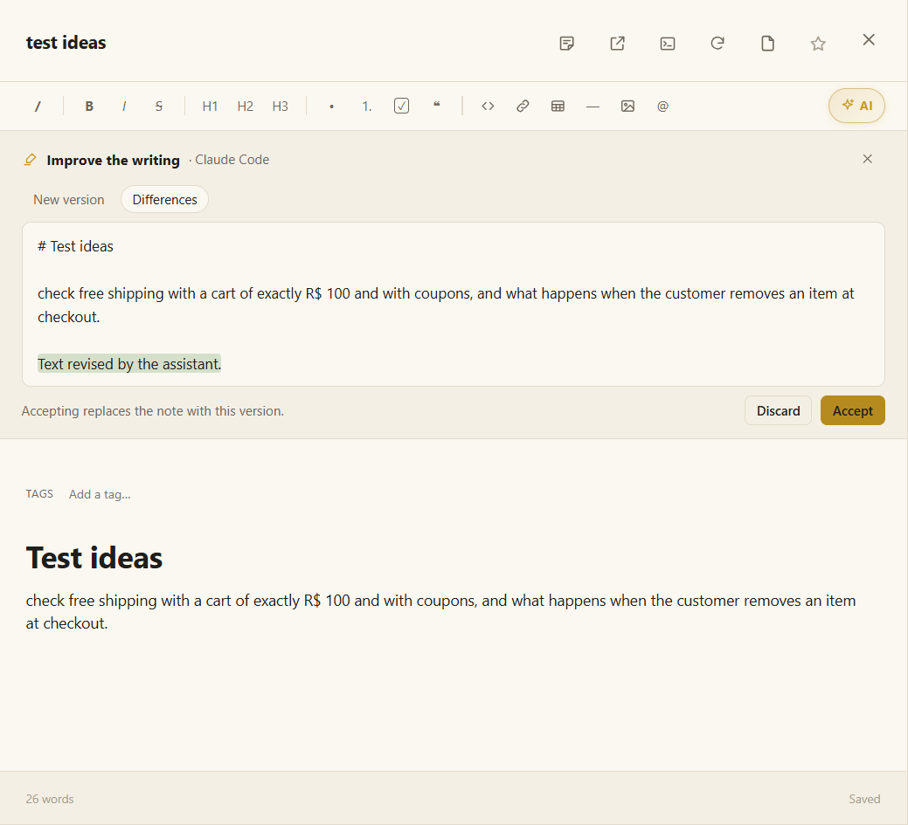

# Notes and quick assistants

Notes are where you think: test ideas, meeting notes, questions for the team, a draft before it becomes a document. They are Markdown, open formatted, and **save on their own**.

## Two kinds of notes

| | Loose note | Project note |
|---|---|---|
| **Where it lives** | On this computer, outside any project | In the project's `notes/` folder |
| **How to create it** | The 📝 button at the bottom of the icon rail | **New note** in the project, or send a loose note to a project |
| **Who can see it** | Only you, in Moki | The AI working on the project, and anyone who gets the project folder |

A note opens in the main area. The ↗ button opens it in the **notebook**, a window of its own with one tab per note.

## Writing

- **The title** is in the header. **Double-click it** (or right-click) to rename the note; Enter keeps the new name.
- **Send to a project** — a loose note has, at the right of its header, the project to send it to.
- **Type `/`** for the commands menu, **`@`** to mention a file of the project, and **paste or drop images** right into the note.
- **Ctrl+E** shows the Markdown source; the eye button brings back the formatted note.
- The ☆ makes it a favorite; tags (in a project note) share it with other projects.
- **Export** a project note as **PDF**, **Markdown** or **text**: a save dialog asks where.
- In a PDF, **Create a note from here** turns a selection into a note with the quote and its source; and a note can be **dragged into a PDF** to sit between its pages.

## ✦ Quick assistants

Four assistants help with the note in one click, **without opening a terminal**:

| | Assistant | What it does | Where the answer goes |
|---|---|---|---|
| 🖍️ | **Improve the writing** | Fixes spelling and grammar, makes sentences direct, organizes with headings and lists — keeping every fact, link and image. | Replaces the note |
| ☰ | **Summarize** | 3 to 5 points with only what the note says. | At the top |
| 🔎 | **Research (Sherlock)** | Researches the subject on the web and brings what is missing, each point with the link it came from. | At the end |
| ⚠️ | **Review critically (Moriarty)** | Points out claims without support, contradictions, gaps and the questions a reader would ask. | At the end |

They are the group marked **✦ AI** in the note's toolbar. When the note is narrow, the group folds into **✦ AI** — click it to open the four.

### How it works

1. Click an assistant. Your AI runs once in the background — **Claude Code** or **Codex**, your default first — in an empty temporary folder, with **no tool that writes files or runs commands** (only research searches the web).
2. The answer comes back as a **suggestion** above the note. For *Improve the writing*, the **Differences** tab shows word by word what comes in and what goes.
3. **Accept** applies it; **Discard** throws it away. **Nothing changes in the note until you accept.**

You can cancel while it works. They work in loose notes too, without any project.

> [!NOTE]
> The quick assistants need Claude Code or Codex installed and logged in. Without either, the note says so and links to **Settings › My AIs**.

## See also

- [Files and the editor](files-and-editor.md) — the same editor, for any Markdown file.
- [Calling activities, agents and skills](call.md) — for bigger work on a note, in a terminal.
