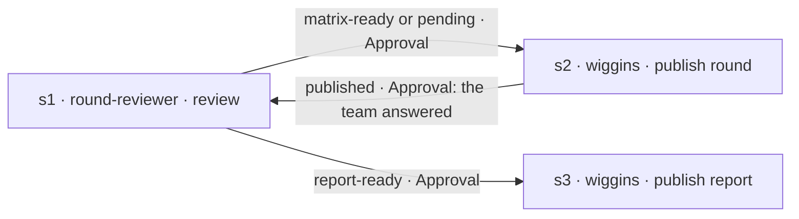

# Operation recipes

Ready-made designs for **Settings › Operations**. Build one by following its tables: add the steps, draw the arrows with the gate, the map and the result shown, then link the operation to a project. How operations work: [agents.md › Multi-agent operations](agents.md#multi-agent-operations).

The agents below already declare what they need (inputs), what they deliver (outputs) and the results they end with (outcomes), so the arrows can branch on them. Inside an operation they use the operation's run folder and keep their own approval points ([persistence protocol](../core/persistence-protocol.md#inside-a-multi-agent-operation)).

## Pente-fino — MF review with the team

The round reviewer reviews the MF, Wiggins posts each round of questions on it, the analyst reads the answers (returned matrix or comments) until everything is defined, and Wiggins posts the final report.

| Step | Agent | What happens |
|---|---|---|
| s1 (start) | `round-reviewer` | First visit: reads the MF (number or URL), static review, interview (one question at a time, in its terminal), cross-validation, G1, matrix; prepares `publication-round-1.md`; ends `matrix-ready`. Later visits: reads the answers (returned matrix and the MF's comments), GC; either prepares the next round (`publication-round-<n>.md`, ends `pending`) or asks G3, generates the PDF and prepares `publication-report.md` (ends `report-ready`). |
| s2 | `wiggins` | Shows the exact comment, attachment and item; publishes after your OK; writes `publication-report.md`; ends `published`, `partly-published` or `not-published`. |
| s3 | `wiggins` | Same, for the final report. |

| Arrow | Gate | Map ("input" ← output) | Result |
|---|---|---|---|
| s1 → s2 | Approval | "Publication to make" ← `publication-*.md` | `matrix-ready` |
| s1 → s2 | Approval | "Publication to make" ← `publication-*.md` | `pending` |
| s2 → s1 | **Approval** — approve when the team has answered (the run waits for you meanwhile) | — | `published` |
| s1 → s3 | Approval | "Publication to make" ← `publication-*.md` | `report-ready` |

- Start form: "MF number or URL".
- Every visit of s1 delivers the current matrix and one publication file (`publication-round-<n>.md` or `publication-report.md`), so the map is the same on every arrow.
- For a review in one conversation, without an operation, use the activity "Review an MF from the tracker" (the `requirements-analyst`).
- Times a step may run: 4 (the first review plus up to three rounds of answers).
- `partly-published` and `not-published` have no arrow: the run stops and asks you how to go on (retry the step, or continue).
- Tracker connection: [trackers.md](trackers.md). Without it, Wiggins hands over the comment and the files for you to post, and you continue the run when the team answers.
