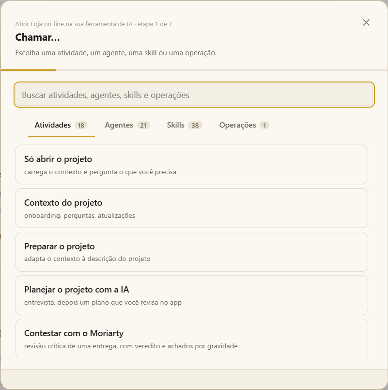

# Chamar atividades, agentes e skills

O **Chamar…** é como você pede algo à IA num projeto. Ele está no painel do projeto, no ▶ da barra de ícones e no **Ctrl+Shift+K** (macOS: Cmd+Shift+K).

## O que dá para chamar

| Aba | O que é | Exemplo |
|---|---|---|
| **Atividades** | Um pedido pronto: o que pedir, a qual skill ou agente, com quais arquivos. | *Revisar histórias de usuário* |
| **Agentes** | Um papel com instruções próprias, para trabalhar junto ou para conversar sobre uma ideia. | *sherlock* — investiga um assunto |
| **Skills** | Um procedimento que a IA segue passo a passo. | *test-design* |
| **Operações** | Vários agentes ligados por setas, cada um no seu terminal. | Uma revisão que vai para o time e volta |

A lista abre em **Atividades** (ou no tipo do padrão do projeto). A busca procura em todas as abas, e cada aba mostra quantos encontrou. Os **padrões** do projeto vêm primeiro, marcados como *Padrão*; os seus favoritos (☆) logo depois.

## Passo a passo

1. **Escolha** o que chamar.
2. **Arquivos** — marque os arquivos da entrada que a IA deve usar (algumas atividades exigem pelo menos um).
3. **Contexto compartilhado** — quando as tags trazem arquivos de outros projetos, desmarque o que este pedido não deve usar.
4. **Quem faz** — opcionalmente, um agente para uma skill (ou *deixar a skill decidir*).
5. **Algo mais** — uma observação com as suas palavras (*foque nas permissões*) e o idioma em que a IA fala com você.
6. **Onde** — **Neste terminal** cola o pedido onde está o cursor do terminal de IA em que você está, sem enviar; **Num terminal novo** abre um.
7. **Qual IA** — a sua padrão já vem escolhida; outra escolha vale só para este pedido.
8. **Revisar** e abrir.

Uma **operação** sempre abre o próprio formulário de início, porque cada etapa dela roda no seu próprio terminal.

> [!TIP]
> **Para conversar sobre uma ideia**, escolha um agente e escreva o assunto na observação. Nenhuma execução começa, a não ser que o procedimento do agente ou o seu pedido peça.

## As atividades que vêm com o Moki

| Atividade | O que você recebe |
|---|---|
| **Revisar histórias de usuário** | Ambiguidades, lacunas e uma entrevista, depois uma matriz de revisão e um relatório de definições finais. |
| **Revisar MF do tracker** | A mesma revisão, lendo o item do Azure DevOps ou do Jira pelo número ou URL. |
| **Desenhar testes** | Mapeamento de cenários e, depois do seu OK, os casos de teste. |
| **Revisar e depois desenhar testes** | As duas coisas, com a sua aprovação no meio. |
| **Pré-análise de falha** | A partir da sua descrição e do log: onde provavelmente falha, e um caminho para os desenvolvedores. |
| **Montar evidências de teste** | A partir do item e das gravações, uma planilha e um documento Word de evidências. |
| **Registrar itens com o Lestrade** | Bugs, tarefas, impedimentos ou qualquer tipo de item do Azure DevOps ou do Jira, a partir do seu material, depois de você aprovar a prévia. |
| **Investigar com o Sherlock** | Pesquisa a fundo com referências que você pode conferir, entregue como dossiê. |
| **Contestar com o Moriarty** | Uma revisão crítica de uma entrega, com os achados em ordem de gravidade e um veredito. |
| **Escrever um documento com o Watson** | Qualquer documento, organizado, diagramado e conferido, com diagramas. |
| **Validar uma API com o Sentinela** | Contratos, cobertura e permissões, e uma execução aprovada com evidências. |
| **Desenhar uma solução com o Inventor** | Problema, requisitos, alternativas, arquitetura e plano de entrega. |
| **Modelar dados com o Cartógrafo** | Entidades, relacionamentos, dicionários e estruturas de banco de dados. |
| **Prototipar uma interface com o Artesão** | Um protótipo de interface funcionando, revisado no navegador. |

O cartão **Skills e agentes** do painel do projeto é um atalho: o ▶ dele pede para a IA usar aquela skill ou agente, no terminal de IA em foco ou num novo.

Você pode escrever **as suas próprias atividades** em **Configurações › Atividades**. Mais: [Atividades](activities.md) · [Skills de QA e agentes](qa-skills.md) · [Agentes e operações](../agents.md).

## O que acontece depois

A IA segue o procedimento da skill e **para nos pontos de aprovação** — um plano de testes, um bug antes de ser publicado — e espera por você no terminal. Dúvidas e definições são respondidas na conversa; documentos chegam em **Arquivos de execuções** e abrem ao lado do terminal. Veja [Execuções e entregas](runs.md).
