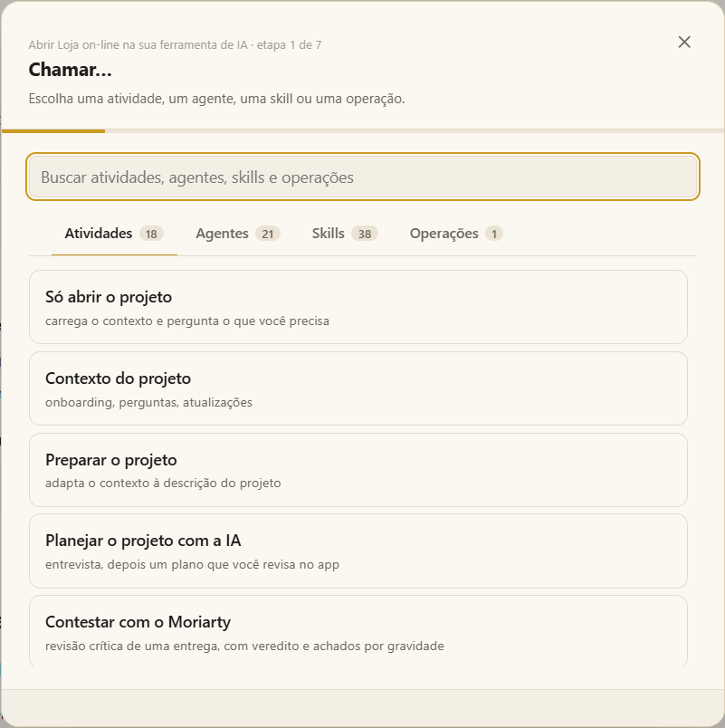

# Primeiros passos

Do zero ao seu primeiro pedido para a IA, em uns cinco minutos.

## 1. Instale o Moki

### Windows

1. Baixe o [Moki.Setup.0.5.2.exe](https://github.com/Orsi88/moki/releases/download/v0.5.2/Moki.Setup.0.5.2.exe) (ou o arquivo mais recente em [Releases](https://github.com/Orsi88/moki/releases)).
2. Se o Windows disser que protegeu o computador, escolha **Mais informações → Executar assim mesmo**. O instalador ainda não tem assinatura digital.
3. Conclua. Um atalho **Moki** aparece na área de trabalho e no menu Iniciar.

A primeira abertura cria **Documentos\Moki**: os arquivos do app e a sua `workspace/`, onde ficam os projetos. Um instalador mais novo atualiza os arquivos do app e nunca mexe em `workspace/` e `workspaces/`; desinstalar também mantém essas pastas.

### macOS e Linux

Rode o Moki a partir do código — veja [A partir do código](#a-partir-do-código), mais abaixo.

### A sua ferramenta de IA

O Moki trabalha com a IA que você já usa. Instale pelo menos uma: [Claude Code](https://code.claude.com/docs/en/setup), [Codex](https://github.com/openai/codex), [Gemini CLI](https://github.com/google-gemini/gemini-cli), Cursor, ou simplesmente um chat da web. O Moki encontra o que está instalado em **Configurações › Minhas IAs**, e consegue instalar uma IA de terminal que falte.

> [!NOTE]
> As atividades que vêm com o app e geram Excel, Word e PDF precisam do [Node.js 22.18+](https://nodejs.org) (LTS). O app em si abre sem ele.

## 2. Escolha um workspace

Abra o Moki. A primeira tela lista os seus **workspaces** — como os cofres do Obsidian. A `workspace/` que você já tem é o primeiro. No canto, você escolhe **inglês ou português** e o tema **claro ou escuro**.

<details>
<summary>Mais sobre workspaces</summary>

Um workspace é uma pasta com seus próprios projetos, tags e configurações — por exemplo, um por cliente ou empresa. Na primeira tela você pode:

- abrir um workspace da lista (o último aberto vem marcado);
- **criar um workspace novo** — por padrão em `workspaces/<nome>/` dentro da pasta do Moki, ou numa pasta que você escolher;
- **abrir uma pasta como workspace** — uma pasta que você já tem; o Moki cria uma pasta `projects/` dentro dela;
- renomear um, ou tirá-lo da lista (a pasta continua no computador).

Troque de workspace no rodapé da lista de projetos, ou volte para a lista em *Gerenciar workspaces…*. Os projetos de um workspace nunca enxergam outro.

</details>

## 3. Crie o seu primeiro projeto

Clique no **+** ao lado da lista de projetos e digite um nome — por exemplo *Loja on-line* — e **Enter**. O projeto abre na hora, com as pastas de sempre:

| Pasta | O que vai nela |
|---|---|
| **Contexto** | O que está confirmado sobre o sistema. Começa vazia e vai enchendo conforme você confirma definições. |
| **Entrada** | Os arquivos que você entrega à IA. |
| **Arquivos de execuções** | O que cada trabalho entregou. |
| **Notas** | As suas notas sobre o projeto. |
| **Temporários** | Arquivos de rascunho; o que tem mais de 7 dias vai para a lixeira. |

> [!TIP]
> Já tem o código ou os documentos do sistema numa pasta? **Abra um projeto** e escolha essa pasta: o Moki a vincula e a mostra no topo da árvore, ao vivo — nada é copiado.

## 4. Entregue um arquivo

Arraste para a janela a história de usuário, o log, a planilha ou o PDF com que você está trabalhando. Ele é copiado para a **Entrada** (até 40 arquivos, 200 MB cada). Clique para abrir: Markdown abre no editor, PDFs e imagens no visualizador, Word e Excel como prévia.

## 5. Chame a IA

Clique em **Chamar…** no painel do projeto, à direita (ou **Ctrl+Shift+K**).

1. Escolha o que você quer — por exemplo **Revisar histórias de usuário** em *Atividades*, ou o agente **sherlock** em *Agentes*.
2. Marque os arquivos da entrada que ele deve usar.
3. Escreva uma observação se quiser (*foque nos cupons*), escolha **Num terminal novo** e a sua IA.

A IA abre numa aba de terminal dentro do Moki com o pedido pronto, segue o procedimento da skill e para sempre que precisa de uma decisão sua. O que ela entrega aparece em **Arquivos de execuções** e abre ao lado do terminal dela.



## E agora?

- 👀 [Tour pela tela](tour.md) — cada parte da janela, explicada.
- 🧠 [Projetos e workspaces](projects.md) — contexto, tags e compartilhamento.
- 📞 [Chamar atividades, agentes e skills](call.md) — tudo o que o **Chamar…** faz.

---

## A partir do código

Use isto para rodar o Moki no macOS ou no Linux, ou para mudar o app. Quem instalou o `.exe` no Windows pode pular.

Você precisa do Git e do Node.js 22.18 ou mais novo.

```bash
git clone https://github.com/Orsi88/moki.git
cd moki
npm run setup
npm run qa
```

O `npm run setup` instala as ferramentas, monta o app, cria a `workspace/` e liga a verificação que impede commit de dados de projeto ou segredos. Rode de novo depois de `git pull`.

| Comando | O que faz |
|---|---|
| `npm run qa` | Abre o app. Com `npm link` uma vez, `qa` funciona de qualquer pasta. |
| `qa --terminal` | A mesma preparação num menu de terminal, se você preferir à janela (em inglês; qualquer id de projeto serve). |
| `npm run new-project -- <id> "<Nome>" [--blank]` | Cria a pasta de um projeto. `--blank` deixa de fora os arquivos de contexto de QA. |
| `npm run dist:win` / `dist:mac` / `dist:linux` | Gera um instalador naquele sistema. Sai em `release/`. |
| `npm run vscode:package` | Gera a extensão do VS Code (`release/moki-<versão>.vsix`). Veja [Moki na IDE](ide.md). |
| `npm run check` e `npm test` | Validam o repositório e rodam os testes. |

<details>
<summary>Ubuntu ou WSL: "Unknown file extension .ts"</summary>

Algumas versões do Node.js empacotadas pelo Ubuntu não têm suporte nativo a TypeScript, mesmo numa versão compatível (visto com o Node.js v22.22.1 em `/usr/bin/node`):

```text
TypeError [ERR_UNKNOWN_FILE_EXTENSION]: Unknown file extension ".ts"
```

Instale o Node.js oficial pelo [NVM](https://github.com/nvm-sh/nvm):

```bash
nvm install 22
nvm use 22
nvm alias default 22
node -p "process.features.typescript"   # deve mostrar: strip
npm run qa
```

Só atualizar o Ubuntu ou conferir a versão do Node.js pode não resolver: a distribuição e a configuração de build também contam.

</details>
