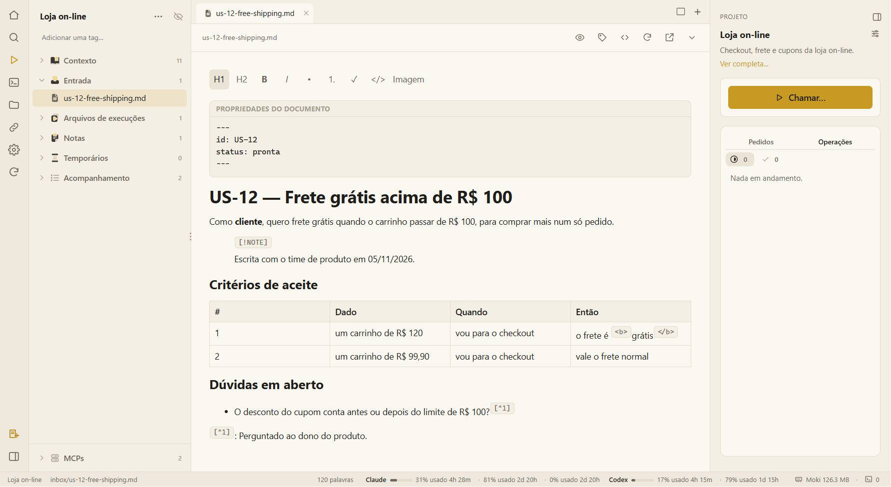

# 🐾 Moki

**Seu espaço local para trabalhar com IA.**

O Moki guarda cada projeto — contexto, arquivos, notas e entregas — numa pasta da sua máquina e abre o Claude Code, o Codex, o Gemini, o Cursor ou um chat da web com o pedido já escrito. Você escolhe o trabalho; o Moki organiza o projeto, entrega o material certo à IA e mantém o resultado onde você pode continuar.

O Moki não é uma IA nem um serviço de nuvem. Ele é o espaço local do projeto, o ambiente de documentos e a camada de orquestração em volta das ferramentas de IA que você já usa.

---

## 🚀 Comece em 5 minutos

1. **[Instale o Moki](getting-started.md)** — um instalador no Windows; no macOS e no Linux, a partir do código.
2. **Crie um projeto** — dê um nome, abra uma pasta existente ou comece com um projeto em branco.
3. **Adicione material** — solte arquivos na entrada, escreva uma nota ou confirme o contexto do projeto.
4. **Clique em Chamar…** — escolha uma atividade, agente, skill ou operação e a IA abre com tudo pronto.

Primeira vez? Leia **[O que é o Moki](what-is-moki.md)** e faça o **[tour pela tela](tour.md)**.

---

## 🧭 O que você quer fazer?

| | Quero… | Onde |
|---|---|---|
| 🗂️ | Organizar projetos, contexto e pastas vinculadas | [Projetos e workspaces](projects.md) |
| 📝 | Pensar, rascunhar, resumir ou pesquisar numa nota | [Notas e assistentes rápidos](notes.md) |
| 🤖 | Iniciar pedidos reutilizáveis com uma IA | [Chamar atividades, agentes e skills](call.md) |
| 🔗 | Encadear vários agentes numa operação | [Agentes e operações](../agents.md) |
| 📄 | Ler e editar documentos, PDFs e HTML | [Arquivos e editor](files-and-editor.md) |
| 🖍️ | Revisar trechos, páginas ou regiões com comentários | [Arquivos e editor](files-and-editor.md) |
| ◇ | Abrir, criar e revisar diagramas e desenhos | [Arquivos e editor](files-and-editor.md) |
| 🔔 | Agendar verificações e revisar notificações | [Rotinas e notificações](routines.md) |
| 🔌 | Dar à IA navegadores, trackers ou outras ferramentas | [Servidores MCP](mcp-servers.md) |
| 🖥️ | Usar o projeto no VS Code ou no Cursor | [Moki na IDE](ide.md) |
| 🧪 | Usar os fluxos prontos de qualidade | [Skills de QA e agentes](qa-skills.md) |
| 🧩 | Adicionar suas próprias skills, agentes e atividades | [Atividades](activities.md) |

Os fluxos de qualidade são uma parte do Moki. O mesmo modelo de projetos, notas, documentos, integrações e orquestração de IA serve para pesquisa, documentação, engenharia, interfaces, APIs, dados e outros trabalhos.

---

## 👀 Por dentro

*Um projeto: as pastas à esquerda, um documento aberto no editor e o painel do projeto com o **Chamar…** à direita.*

---

## ❤️ Feito com software livre

O Moki existe graças a projetos livres e de código aberto. **Obrigado** a cada pessoa que os constrói e mantém.

### 🏗️ Frameworks

| Framework | O que ele faz no Moki | Licença |
|---|---|---|
| [Electron](https://www.electronjs.org) | O próprio app de desktop, no Windows, macOS e Linux | MIT |
| [React](https://react.dev) | Todas as telas do app | MIT |
| [TipTap](https://tiptap.dev) | O editor de Markdown dos documentos e das notas | MIT |
| [ProseMirror](https://prosemirror.net) | O motor de edição por baixo do TipTap | MIT |
| [Playwright](https://playwright.dev) | Os testes automáticos que clicam pelo app — e tiram os prints desta wiki | Apache-2.0 |

### 🧰 Outras ferramentas de código aberto

| Ferramenta | O que ela faz no Moki | Licença |
|---|---|---|
| [Node.js](https://nodejs.org) | Os scripts do Moki e o motor do app | MIT |
| [TypeScript](https://www.typescriptlang.org) | A linguagem em que o Moki é escrito, e a checagem de tipos | Apache-2.0 |
| [Vite](https://vite.dev) e [@vitejs/plugin-react](https://github.com/vitejs/vite-plugin-react) | A construção das telas do app | MIT |
| [esbuild](https://esbuild.github.io) | A construção do processo principal e da extensão da IDE | MIT |
| [xterm.js](https://xtermjs.org) e [@xterm/addon-fit](https://github.com/xtermjs/xterm.js) | Desenhar os terminais onde as ferramentas de IA rodam | MIT |
| [node-pty](https://github.com/microsoft/node-pty) | Um processo de shell de verdade por trás de cada terminal | MIT |
| [PDF.js](https://mozilla.github.io/pdf.js/) | Mostrar PDFs com texto selecionável | Apache-2.0 |
| [pdf-lib](https://pdf-lib.js.org) | Gravar destaques, comentários e edições de página nos PDFs | MIT |
| [Mermaid](https://mermaid.js.org) | Diagramas desenhados dentro dos documentos | MIT |
| [Excalidraw](https://excalidraw.com) | Desenhos no estilo feito à mão, editáveis | MIT |
| [marked](https://marked.js.org) | A leitura do Markdown para o editor | MIT |
| [electron-builder](https://www.electron.build) | Os instaladores | MIT |
| [vsce](https://github.com/microsoft/vscode-vsce) | O empacotamento da extensão do VS Code | MIT |
| [DefinitelyTyped](https://github.com/DefinitelyTyped/DefinitelyTyped) | Os tipos usados na construção | MIT |

A lista completa, com o que cada um faz e onde está a licença: **[Créditos e licenças](credits.md)**.

---

## 🗺️ Para se localizar

- **Comece por aqui** — [O que é o Moki](what-is-moki.md) · [Primeiros passos](getting-started.md) · [Tour pela tela](tour.md)
- **Dia a dia** — [Projetos e workspaces](projects.md) · [Arquivos e editor](files-and-editor.md) · [Notas e assistentes rápidos](notes.md) · [Terminais de IA](ai-terminals.md) · [Execuções e entregas](runs.md) · [Configurações](settings.md)
- **Trabalho com IA e extensões** — [Chamar atividades, agentes e skills](call.md) · [Atividades](activities.md) · [Agentes e operações](../agents.md) · [Receitas de operação](operation-recipes.md) · [Especialistas de engenharia](engineering-specialists.md)
- **Integrações** — [Servidores MCP](mcp-servers.md) · [Azure DevOps e Jira](trackers.md) · [Moki na IDE](ide.md) · [Apps ArtCraft](artcraft.md) · [Rotinas e notificações](routines.md)
- **Fluxos especializados** — [Skills de QA e agentes](qa-skills.md)
- **Ajuda** — [Problemas comuns](troubleshooting.md) · [Privacidade e isolamento](../privacy-and-isolation.md)

Algo confuso ou faltando? [Abra uma issue](https://github.com/Orsi88/moki/issues) — a documentação faz parte do produto.
