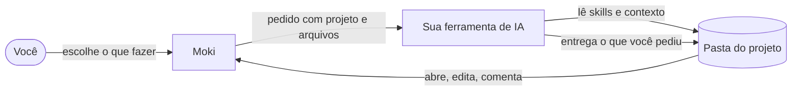
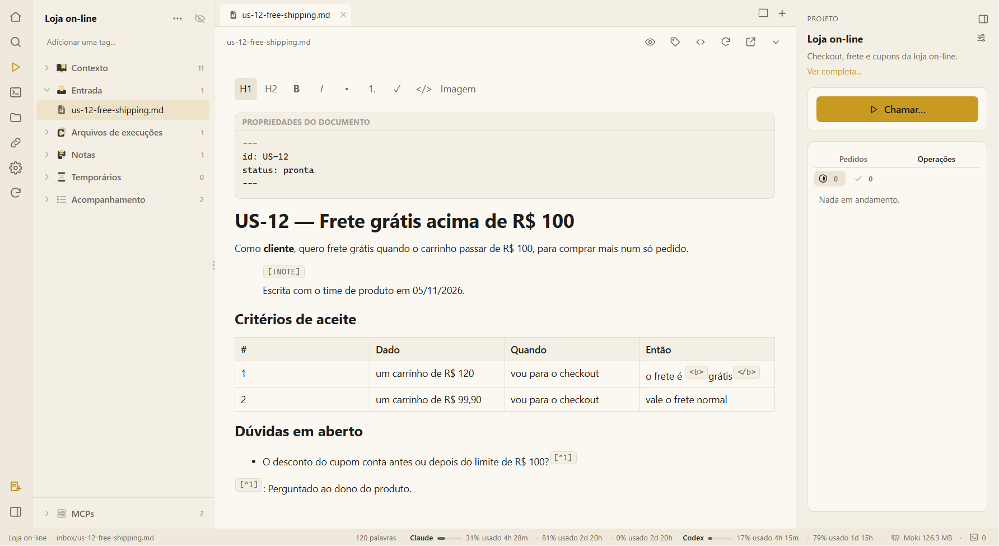

# 🐾 Moki

**Sua mesa de QA, no seu computador, com a IA que você já usa.**

O Moki guarda cada projeto — contexto, arquivos, notas e entregas — numa pasta da sua máquina e abre o Claude Code, o Codex, o Gemini, o Cursor ou um chat da web com o pedido já escrito. A IA faz o trabalho seguindo as skills do Moki; você aprova cada passo importante; os arquivos são a memória, então dá para parar hoje e continuar amanhã em qualquer ferramenta.

 

*O Moki prepara o pedido; a sua IA faz o trabalho na pasta do projeto; o Moki mostra e edita o que ela entregou.*

---

## 🚀 Comece em 5 minutos

1. **[Instale o Moki](getting-started.md)** — um instalador no Windows; no macOS e no Linux, a partir do código.
2. **Crie um projeto** — dê um nome e solte a história, o log ou o documento com que você está trabalhando.
3. **Clique em Chamar…**, escolha o que quer (revisar uma história, desenhar testes, analisar um erro…) e a IA abre com tudo pronto.

Primeira vez? Leia **[O que é o Moki](what-is-moki.md)** e faça o **[tour pela tela](tour.md)**.

---

## 🧭 O que você quer fazer?

| | Quero… | Onde |
|---|---|---|
| 📝 | Revisar uma história antes do desenvolvimento | [Skills de QA e agentes](qa-skills.md) |
| 🧪 | Mapear cenários e escrever casos de teste | [Skills de QA e agentes](qa-skills.md) |
| 🐞 | Pré-analisar um erro a partir do log | [Skills de QA e agentes](qa-skills.md) |
| 📸 | Montar evidências de teste (planilha e Word) | [Skills de QA e agentes](qa-skills.md) |
| 🎫 | Abrir bugs e tarefas no Azure DevOps ou no Jira | [Azure DevOps e Jira](trackers.md) |
| 📄 | Editar e comentar arquivos Word e Excel | [Arquivos e editor](files-and-editor.md) |
| 🌐 | Ver uma página HTML funcionando, com JavaScript | [Arquivos e editor](files-and-editor.md) |
| 🔎 | Pesquisar um assunto a fundo, com fontes | [Skills de QA e agentes](qa-skills.md) |
| ✍️ | Melhorar a escrita de uma nota com um clique | [Notas e assistentes rápidos](notes.md) |
| 🧹 | Limpar os arquivos que a IA deixou para trás | [Execuções e entregas](runs.md) |
| 🖥️ | Usar o Moki dentro do VS Code ou do Cursor | [Moki na IDE](ide.md) |
| 🔌 | Dar ferramentas à IA, como um navegador ou um banco de dados | [Servidores MCP](../mcp-servers.md) |

---

## 👀 Por dentro

*Um projeto: as pastas à esquerda, uma história aberta no editor (o que o editor não desenha, como HTML ou notas de rodapé, fica exatamente como foi escrito) e o painel do projeto com o **Chamar…** à direita.*

---

## ❤️ Feito com software livre

O Moki existe graças a projetos livres e de código aberto. **Obrigado** a cada pessoa que os constrói e mantém.

### 🏗️ Frameworks

| Framework | O que ele faz no Moki | Licença |
|---|---|---|
| [Electron](https://www.electronjs.org) | O próprio app de desktop, no Windows, macOS e Linux | MIT |
| [React](https://react.dev) | Todas as telas do app | MIT |
| [TipTap](https://tiptap.dev) | O editor de Markdown dos documentos e das notas | MIT |
| [ProseMirror](https://prosemirror.net) | O motor de edição por baixo do TipTap | MIT |
| [Playwright](https://playwright.dev) | Os testes automáticos que clicam pelo app — e tiram os prints desta wiki | Apache-2.0 |

### 🧰 Outras ferramentas de código aberto

| Ferramenta | O que ela faz no Moki | Licença |
|---|---|---|
| [Node.js](https://nodejs.org) | Os scripts do Moki e o motor do app | MIT |
| [TypeScript](https://www.typescriptlang.org) | A linguagem em que o Moki é escrito, e a checagem de tipos | Apache-2.0 |
| [Vite](https://vite.dev) e [@vitejs/plugin-react](https://github.com/vitejs/vite-plugin-react) | A construção das telas do app | MIT |
| [esbuild](https://esbuild.github.io) | A construção do processo principal do app e da extensão da IDE | MIT |
| [xterm.js](https://xtermjs.org) e [@xterm/addon-fit](https://github.com/xtermjs/xterm.js) | Desenhar os terminais onde as ferramentas de IA rodam, no tamanho da aba | MIT |
| [node-pty](https://github.com/microsoft/node-pty) | Um processo de shell de verdade por trás de cada terminal | MIT |
| [PDF.js](https://mozilla.github.io/pdf.js/) | Mostrar PDFs com texto selecionável | Apache-2.0 |
| [pdf-lib](https://pdf-lib.js.org) | Gravar destaques, comentários e edições de página nos PDFs | MIT |
| [Mermaid](https://mermaid.js.org) | Diagramas desenhados dentro dos documentos | MIT |
| [Excalidraw](https://excalidraw.com) | Desenhos no estilo feito à mão, editáveis | MIT |
| [marked](https://marked.js.org) | A leitura do Markdown para o editor | MIT |
| [electron-builder](https://www.electron.build) | Os instaladores | MIT |
| [vsce](https://github.com/microsoft/vscode-vsce) | O empacotamento da extensão do VS Code | MIT |
| [DefinitelyTyped](https://github.com/DefinitelyTyped/DefinitelyTyped) | Os tipos do Node.js, do React e do VS Code usados na construção | MIT |

A lista completa, com o que cada um faz e onde está a licença: **[Créditos e licenças](credits.md)**.

---

## 🗺️ Para se localizar

- **Comece por aqui** — [O que é o Moki](what-is-moki.md) · [Primeiros passos](getting-started.md) · [Tour pela tela](tour.md)
- **Dia a dia** — [Projetos e workspaces](projects.md) · [Arquivos e editor](files-and-editor.md) · [Notas e assistentes rápidos](notes.md) · [Terminais de IA](ai-terminals.md) · [Chamar atividades, agentes e skills](call.md) · [Execuções e entregas](runs.md) · [Configurações](settings.md)
- **Trabalho de QA** — [Skills de QA e agentes](qa-skills.md) · [Atividades](activities.md)
- **Ajuda** — [Problemas comuns](troubleshooting.md) · [Privacidade e isolamento](../privacy-and-isolation.md)

Algo confuso ou faltando? [Abra uma issue](https://github.com/Orsi88/moki/issues) — a documentação faz parte do produto.
