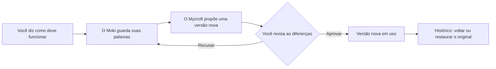

# Mycroft: ensine o Moki a trabalhar do seu jeito

O Mycroft é o agente que adapta o Moki a você. Quando você diz como um agente, uma skill ou uma atividade deve funcionar da próxima vez ("numere os casos de teste TC-001", "sempre pergunte o ambiente primeiro"), o Moki guarda o que você disse. O Mycroft transforma isso numa mudança pequena e deixa esperando por você. Nada muda até você aprovar, e toda mudança pode ser desfeita.

## Como funciona

*Do que você disse até a versão em uso: só o seu clique muda o que o Moki usa.*

- **Cada mudança aprovada é uma versão nova** do item. A versão anterior não é apagada: fica no histórico do item, fora das listas.
- **Os arquivos do próprio Moki nunca mudam.** Num agente, skill ou atividade que vem com o Moki, a sua versão fica no seu workspace e é usada no lugar da do Moki. Ela continua valendo depois das atualizações do Moki.
- **Restaurar o original** faz o Moki voltar a usar a própria versão; as suas versões ficam no histórico.
- **Só você aprova.** Nenhuma IA aplica uma versão, nem o Mycroft. Aprovar, recusar, voltar e restaurar acontecem só no app.

## Ensinar algo

Há dois jeitos:

1. **Numa conversa.** Enquanto trabalha com qualquer agente, diga: *"da próxima vez, coloque o resultado esperado numa coluna própria"*. A IA guarda suas palavras para aquele item pelo servidor MCP do Moki (`moki_record_learning`). Se vale só para o projeto atual, diga isso; o aprendizado fica no projeto.
2. **Na página do item.** Abra **Configurações › Agentes**, **Skills** ou **Atividades**, abra o item e escreva em **Evolução › Ensinar algo a este item**.

## Pedir uma proposta ao Mycroft

Chame o Mycroft como qualquer agente (ele está ativo em todos os projetos) e peça: *"revise o que eu ensinei"*. O Mycroft:

1. lista os aprendizados em aberto, item por item;
2. pergunta quando dois deles se contradizem (por exemplo "passos curtos" e "passos detalhados"), sem escolher por você;
3. escreve a menor mudança que faz o que você pediu, mantendo os títulos, os pontos de aprovação e as regras do item;
4. deixa como proposta e diz onde aprová-la.

O Moki confere cada proposta antes de guardá-la: uma skill mantém as seções obrigatórias e o nome, um agente mantém nome, categoria e nível de acesso, uma atividade continua válida. Uma proposta que quebra uma regra é recusada, e o Mycroft corrige ou avisa.

## Aprovar, recusar, voltar

Uma proposta esperando aparece no sino de notificações (**O Mycroft tem 1 melhoria esperando você**) e na página do item, em **Evolução**:

| Na página do item | O que faz |
|---|---|
| **Aprovar** | A proposta vira a próxima versão e é usada a partir do próximo pedido |
| **Recusar** | A proposta é descartada; os seus aprendizados continuam em aberto |
| **Ver diferenças** | O que uma versão mudou, linha por linha (removido em vermelho, adicionado em verde) |
| **Voltar para esta versão** | Depois de você confirmar, o texto daquela versão volta a ser usado, como uma entrada nova no histórico |
| **Restaurar o original** | Depois de você confirmar, o texto do próprio Moki (ou, num item seu, o primeiro texto dele) volta a ser usado |
| **Comparar com o original** | A versão em uso ao lado do original |

Quando o Moki traz uma versão mais nova de um item que você mudou, a página avisa. Peça ao Mycroft para levar as suas mudanças para a versão nova; ele as propõe de novo sobre o texto novo do Moki.

## Bom saber

- Os aprendizados do workspace inteiro ficam em `workspace/library/evolution/`; os de um projeto, em `workspace/projects/<project-id>/learnings.jsonl`. O Mycroft lê só os do workspace e os do projeto atual.
- Os subagentes nativos do Claude Code (`.claude/agents/`) são gerados dos arquivos originais do Moki. Os pedidos iniciados pelo Moki (app, painel da IDE, operações) usam sempre a versão em uso.
- Criar um agente, skill ou atividade novo é trabalho do Configurador; o Mycroft só evolui os que já existem.
