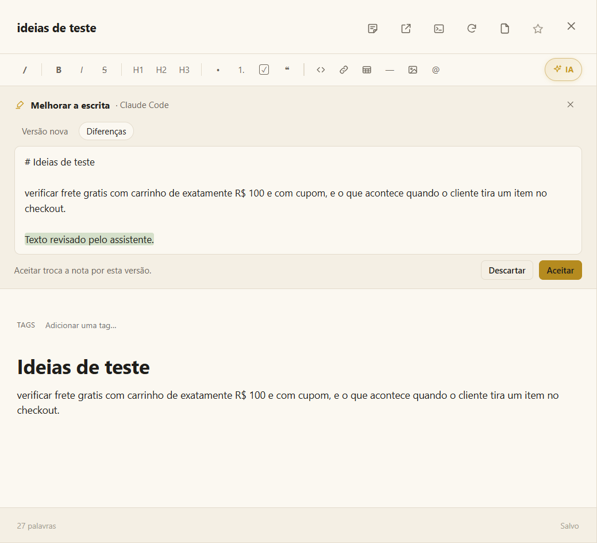

# Notas e assistentes rápidos

As notas são onde você pensa: ideias de teste, anotações de reunião, perguntas para o time, um rascunho antes de virar documento. Elas são Markdown, abrem formatadas e **salvam sozinhas**.

## Dois tipos de nota

| | Nota avulsa | Nota de projeto |
|---|---|---|
| **Onde fica** | Neste computador, fora de qualquer projeto | Na pasta `notes/` do projeto |
| **Como criar** | O botão 📝 no pé da barra de ícones | **Nova nota** no projeto, ou encaminhando uma nota avulsa para um projeto |
| **Quem enxerga** | Só você, no Moki | A IA que trabalha no projeto, e quem receber a pasta do projeto |

A nota abre na área principal. O botão ↗ abre no **bloco de notas**, uma janela própria com uma aba por nota.

## Escrevendo

- **O título** fica no cabeçalho. **Clique duas vezes nele** (ou use o botão direito) para renomear a nota; Enter guarda o nome novo.
- **Encaminhar para um projeto** — a nota avulsa tem, à direita do cabeçalho, o projeto para onde mandá-la.
- **Digite `/`** para o menu de comandos, **`@`** para citar um arquivo do projeto, e **cole ou solte imagens** direto na nota.
- **Ctrl+E** mostra o código-fonte Markdown; o botão do olho traz a nota formatada de volta.
- A ☆ marca como favorita; as tags (numa nota de projeto) compartilham a nota com outros projetos.
- **Usar no terminal** (o `>_` no cabeçalho de uma nota de projeto) manda a nota para a IA como contexto para o que você pedir em seguida.
- **Exporte** uma nota de projeto como **PDF**, **Markdown** ou **texto**: uma janela pergunta onde salvar.
- Num PDF, **Criar nota daqui** transforma uma seleção numa nota com a citação e a fonte; e uma nota pode ser **arrastada para dentro de um PDF**, entre as páginas.

## ✦ Assistentes rápidos

Quatro assistentes ajudam com a nota num clique, **sem abrir terminal**:

| | Assistente | O que faz | Onde a resposta entra |
|---|---|---|---|
| 🖍️ | **Melhorar a escrita** | Corrige ortografia e gramática, deixa as frases diretas e organiza com títulos e listas — mantendo todos os fatos, links e imagens. | Substitui a nota |
| ☰ | **Resumir** | De 3 a 5 pontos, só com o que a nota diz. | No topo |
| 🔎 | **Pesquisar (Sherlock)** | Pesquisa o assunto na web e traz o que falta, cada ponto com o link de onde veio. | No fim |
| ⚠️ | **Revisar criticamente (Moriarty)** | Aponta afirmações sem base, contradições, lacunas e as perguntas que um leitor faria. | No fim |

Eles são o grupo marcado **✦ IA** na barra da nota. Quando a nota está estreita, o grupo se recolhe em **✦ IA** — clique para abrir os quatro.

### Como funciona

1. Clique num assistente. A sua IA roda uma vez em segundo plano — **Claude Code** ou **Codex**, a padrão primeiro — numa pasta temporária vazia, **sem nenhuma ferramenta que grave arquivos ou rode comandos** (só a pesquisa busca na web).
2. A resposta volta como **sugestão** acima da nota. No *Melhorar a escrita*, a aba **Diferenças** mostra palavra por palavra o que entra e o que sai.
3. **Aceitar** aplica; **Descartar** joga fora. **Nada muda na nota até você aceitar.**

Dá para cancelar enquanto ele trabalha. Funciona também em notas avulsas, sem projeto nenhum.

> [!NOTE]
> Os assistentes rápidos precisam do Claude Code ou do Codex instalado e com login feito. Sem nenhum dos dois, a nota avisa e leva para **Configurações › Minhas IAs**.

## Veja também

- [Arquivos e editor](files-and-editor.md) — o mesmo editor, para qualquer arquivo Markdown.
- [Chamar atividades, agentes e skills](call.md) — para trabalhos maiores sobre uma nota, num terminal.
