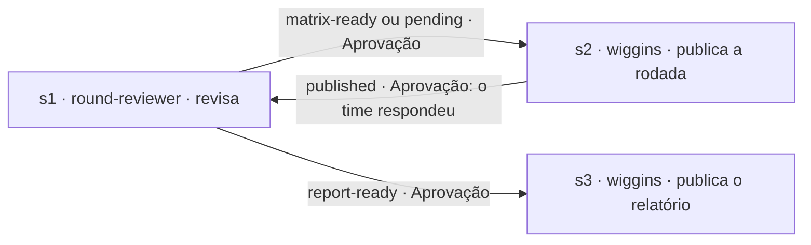

# Receitas de operação

Desenhos prontos para **Configurações › Operações**. Para montar uma, siga as tabelas dela: adicione os passos, desenhe as setas com o tipo (Direta ou Aprovação), o mapeamento e o resultado indicados e depois vincule a operação a um projeto. Como as operações funcionam: [agents.md › Multi-agent operations](../agents.md#multi-agent-operations).

Os agentes abaixo já declaram o que precisam (entradas), o que entregam (saídas) e os resultados com que terminam, para as setas poderem seguir caminhos diferentes. Dentro de uma operação, eles usam a pasta do run da operação e mantêm os próprios pontos de aprovação ([protocolo de persistência](../../core/persistence-protocol.md#inside-a-multi-agent-operation)).

## Pente-fino — revisão de MF com o time

O revisor de rodadas revisa a MF, o Wiggins publica nela cada rodada de dúvidas, o analista lê as respostas (matriz devolvida ou comentários) até tudo estar definido, e o Wiggins publica o relatório final.

| Passo | Agente | O que acontece |
|---|---|---|
| s1 (início) | `round-reviewer` | Na primeira vez: lê a MF (número ou URL), faz a revisão estática, a entrevista (uma pergunta por vez, no terminal dele), a validação cruzada, o G1 e a matriz; prepara `publication-round-1.md`; termina com `matrix-ready`. Nas vezes seguintes: lê as respostas (matriz devolvida e comentários da MF) e passa pelo GC. Depois, ou prepara a próxima rodada (`publication-round-<n>.md`, termina com `pending`), ou pergunta o G3, gera o PDF e prepara `publication-report.md` (termina com `report-ready`). |
| s2 | `wiggins` | Mostra o comentário, o anexo e o item exatos; publica depois do seu OK; escreve `publication-report.md`; termina com `published`, `partly-published` ou `not-published`. |
| s3 | `wiggins` | O mesmo, para o relatório final. |

| Seta | Tipo | Mapeamento ("entrada" ← saída) | Resultado |
|---|---|---|---|
| s1 → s2 | Aprovação | "Publication to make" ← `publication-*.md` | `matrix-ready` |
| s1 → s2 | Aprovação | "Publication to make" ← `publication-*.md` | `pending` |
| s2 → s1 | **Aprovação**: aprove quando o time tiver respondido (enquanto isso, o run espera você) | — | `published` |
| s1 → s3 | Aprovação | "Publication to make" ← `publication-*.md` | `report-ready` |

- Formulário de início: "MF number or URL".
- Toda vez que o s1 roda, ele entrega a matriz atual e um arquivo de publicação (`publication-round-<n>.md` ou `publication-report.md`), então o mapeamento é o mesmo em todas as setas.
- Para uma revisão numa conversa só, sem operação, use a atividade "Revisar MF do tracker" (o `requirements-analyst`).
- Vezes que um passo pode rodar: 4 (a primeira revisão e até três rodadas de respostas).
- `partly-published` e `not-published` não têm seta: o run para e pergunta como seguir (rodar o passo de novo ou continuar).
- Conexão com o tracker: [trackers.md](trackers.md). Sem ela, o Wiggins entrega o comentário e os arquivos para você postar, e você continua o run quando o time responder.
