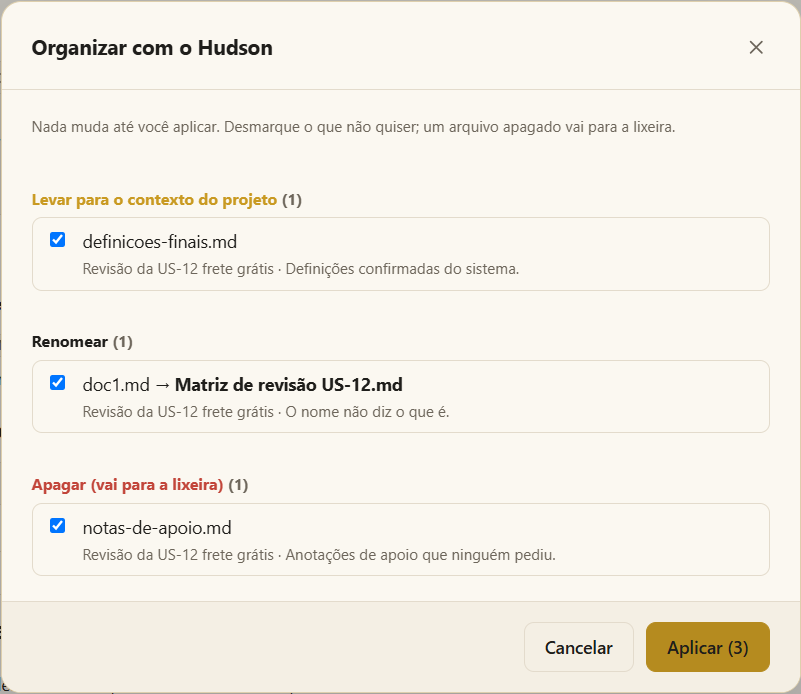

# Execuções e entregas

## Primeiro a resposta; arquivo só quando importa

A maior parte do que você pede é respondida **na conversa**: uma dúvida, uma explicação, uma definição, uma investigação, uma pequena mudança. Nada disso cria arquivo.

A IA só cria uma **execução** — uma pasta em *Arquivos de execuções* — quando:

- você **pede um arquivo**; ou
- o resultado da atividade **é um documento** — uma matriz de revisão, casos de teste, um relatório, evidências, um bug; ou
- o trabalho **para numa aprovação** e precisa ser continuado depois.

Ela nunca escreve documentos de apoio que ninguém pediu (anotações, resumos, planos) nem registros do próprio trabalho. Quando um deles ajudaria, ela oferece numa linha e espera o seu sim.

## O que aparece em Arquivos de execuções

Cada execução mostra **o que foi pedido** — o título dela — e **só as entregas**. Os arquivos internos (o estado que permite retomar, as entradas, os arquivos de apoio) ficam escondidos, mas continuam no disco.

O cartão **Execuções** do painel do projeto lista o mesmo trabalho em **Pedidos**: cada atividade que você começou, o status e o cenário de que tratava. O que espera por você — uma aprovação, uma resposta — vem primeiro em **Precisa de você**, com um ▶ para continuar na sua IA.

## Aprovações e voltar depois

Uma skill para nos seus pontos de aprovação e pergunta no terminal. Se você fechar o app, a execução guarda onde parou: peça à IA para continuar — na mesma ferramenta ou em outra — e ela lê onde estava e segue.

## Só o que você pediu

A IA entrega só os arquivos que você pediu, no formato pedido; quando o formato não está definido, ela pergunta. Nada de cópias em outros formatos, nada de print de planilha. Arquivos de apoio vão para a pasta `work/` da execução e são limpos quando ela termina. Qualquer extra que ainda caia junto das entregas aparece na página da execução em **Sobras**, para mandar para a lixeira.

## O Hudson organiza o que as execuções deixam

Quando os arquivos se acumulam, use **botão direito em Arquivos de execuções › Organizar com o Hudson**.

1. A sua IA (Claude Code ou Codex) olha os arquivos que as execuções deixaram — nunca o estado, as entradas ou os diários delas — e propõe, **arquivo por arquivo e com o motivo**:
   - **Levar para o contexto do projeto** — conhecimento confirmado que vale guardar;
   - **Renomear** — uma entrega cujo nome não diz o que ela é;
   - **Apagar** — anotações de apoio, rascunhos, duplicatas — **para a lixeira**;
   - **Manter** — o que você pediu, ou qualquer coisa de que ela não tenha certeza.
2. **Desmarque** o que você não quiser.
3. **Aplique.** Quem faz as mudanças é o Moki; a IA não mexe em nada. Um arquivo levado para o contexto entra no `context/index.md`.

O Hudson também é um agente: num terminal, peça para ele organizar o projeto e ele mostra o mesmo plano numa tabela e espera a sua aprovação.

## Limpeza automática

- `temporary/` — o que tem mais de **7 dias** vai para a lixeira quando o projeto abre.
- A pasta `work/` de uma execução terminada é limpa quando o projeto abre.
- Opcional, nas configurações do projeto (**Limpeza**): a pasta `outputs/` de uma atividade concluída vai para a lixeira quando o projeto abre, se todos os arquivos que ela entregou estiverem em `context/` (movidos para lá ou como cópia idêntica). Vem desligada.

## Veja também

- [Chamar atividades, agentes e skills](call.md)
- [Projetos e workspaces](projects.md) — o contexto, para onde o Hudson leva documentos confirmados.
