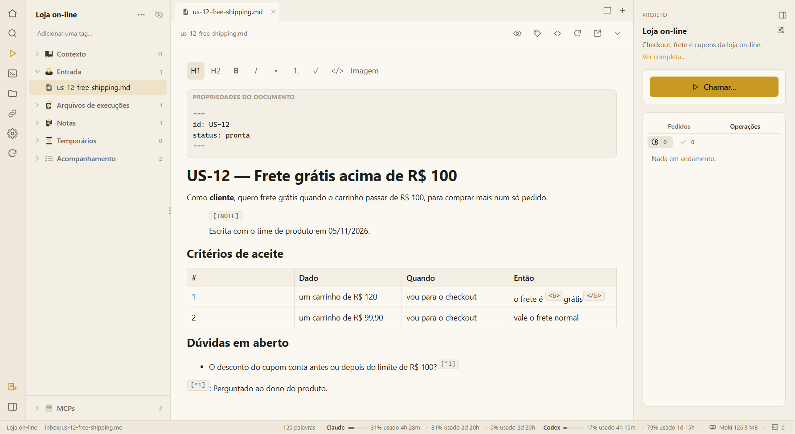

# Tour pela tela

É isto que você vê com um projeto aberto, da esquerda para a direita.

## 1. A barra de ícones (canto esquerdo)

| Ícone | O que faz |
|---|---|
| 🏠 **Todos os projetos** | Volta para a tela inicial: projetos, notas avulsas e o workspace. |
| 🔍 **Buscar** (Ctrl+Shift+F) | Procura no workspace: nomes e descrições dos projetos, e os nomes e o texto dos arquivos deles. As tags funcionam como filtro. |
| ▶ **Abrir na sua ferramenta de IA** | O mesmo que o **Chamar…**: escolher o que a IA deve fazer. |
| `>_` **Novo terminal** | Uma aba de terminal do projeto: o seu shell ou uma ferramenta de IA. |
| 📁 **Abrir a pasta do projeto** | A pasta do projeto no seu gerenciador de arquivos. |
| 🔗 **Vincular uma pasta** | Vincula ao projeto uma pasta do computador (o código do sistema, os documentos dele); ela aparece ao vivo no topo da árvore. Fica destacado quando há pasta vinculada. |
| ⚙️ **Configurações** | Agentes, atividades, suas IAs, operações, skills, servidores MCP e templates. Veja [Configurações](settings.md). |
| 🔄 **Atualizar** | Lê o projeto do disco de novo. |
| 📝 **Nova nota** (embaixo) | Uma nota avulsa, aberta na área principal — fica neste computador até você encaminhá-la a um projeto. |
| ◧ (embaixo) | Mostra ou esconde a barra de arquivos. |

## 2. Os arquivos do projeto (barra lateral)

O nome do projeto com as tags dele, e depois as pastas:

- **Contexto** — o que está confirmado sobre o sistema.
- **Entrada** — o que você entrega à IA. Solte arquivos na janela para acrescentar.
- **Arquivos de execuções** — cada trabalho, pelo que foi pedido, só com as entregas.
- **Notas** — as suas notas.
- **Temporários** — rascunhos, limpos depois de 7 dias.
- **Acompanhamento** — os arquivos que o Moki mantém em dia: atualizações propostas e o registro de atividades.
- **MCPs** (embaixo) — as ferramentas que a IA recebe neste projeto.

Uma **pasta vinculada** vem primeiro, com o próprio nome. O botão direito em qualquer item abre o menu dele: novo arquivo ou pasta, renomear (F2), mostrar na pasta, copiar o caminho ou o link, apagar para a lixeira. Arraste um arquivo para uma pasta para movê-lo.

## 3. Abas e editor (centro)

Cada arquivo abre numa aba. Cada terminal de IA começa o seu próprio **grupo** de abas, com nome e cor, como os grupos de abas do navegador, e os arquivos que a IA entrega abrem no grupo dela. O botão no canto superior direito divide a tela em até quatro visões.

A barra acima de um documento tem, da esquerda para a direita: o modo de leitura (olho), as tags, o código-fonte Markdown (`</>`, Ctrl+E), recarregar do disco, abrir em outro programa e os detalhes do arquivo. Veja [Arquivos e editor](files-and-editor.md).

## 4. O painel do projeto (direita)

- O **nome e a descrição** do projeto; os controles deslizantes abrem as **configurações do projeto**.
- **Chamar…** — o que a IA deve fazer: atividades, agentes, skills e operações. Veja [Chamar atividades, agentes e skills](call.md).
- **Execuções** — *Pedidos* (cada atividade que você começou e onde ela está) e *Operações*, com o que precisa de você no topo.

O botão ◧ no alto recolhe o painel numa barra fina.

## 5. A barra de status (embaixo)

O projeto e o arquivo abertos, a contagem de palavras, quanto você já usou dos seus planos de IA (para o Claude e o Codex, por janela de tempo) e quanta memória o próprio Moki está usando.

## Próximo

➡️ [Projetos e workspaces](projects.md)
