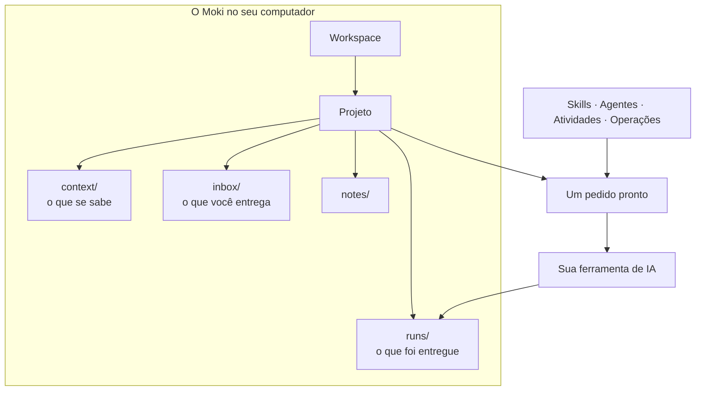

# O que é o Moki

O Moki é uma **mesa de trabalho para qualidade com IA**. Ele não traz uma IA própria: trabalha com a que você já usa — Claude Code, Codex, Gemini, Cursor, Antigravity ou um chat da web — e dá a ela o que precisa para fazer um bom trabalho de QA: o contexto do projeto, os arquivos, um pedido claro e um procedimento para seguir.

Tudo fica **no seu computador**, em pastas comuns e arquivos Markdown que qualquer programa abre.

## A ideia numa imagem

*Um projeto guarda o que se sabe e o que você entrega; o Moki transforma a sua escolha num pedido; a sua IA trabalha no projeto e entrega ali.*

## As palavras que você vai ver

| Palavra | O que significa |
|---|---|
| **Workspace** | Uma pasta com seus próprios projetos, tags e configurações — por exemplo, uma por empresa ou cliente. Os projetos de um workspace nunca enxergam outro. |
| **Projeto** | Um conjunto de trabalho: um sistema que você testa, uma release, um cliente. Tem uma pasta com `context/`, `inbox/`, `notes/` e `runs/`. |
| **Contexto** | O que está *confirmado* sobre o sistema: regras de negócio, glossário, fluxos, ambientes. A IA só trata isto como sabido. |
| **Entrada (inbox)** | Os arquivos que você entrega à IA: uma história, um log, uma planilha, um PDF. |
| **Skill** | Um procedimento que a IA segue passo a passo, com suas regras e pontos de aprovação — por exemplo, *revisão de requisitos* ou *desenho de testes*. |
| **Agente** | Um papel com instruções e skills — o Sherlock investiga, o Watson documenta, o Lestrade registra bugs, o Hudson organiza arquivos. |
| **Atividade** | Um pedido pronto que você escolhe no **Chamar…**: o que pedir, a qual skill ou agente, com quais arquivos. |
| **Operação** | Vários agentes ligados por setas, cada um no seu terminal, passando o trabalho para o próximo. |
| **Execução** | Um trabalho que produziu um documento ou que espera a sua aprovação. As entregas dela são o que você vê na árvore. |

## Como o Moki se comporta

- 🏠 **Local primeiro.** Os projetos ficam em `Documentos\Moki` (ou na pasta que você escolher). Nada é enviado para lugar nenhum, a não ser pela sua ferramenta de IA.
- 🧱 **Projetos isolados.** A IA lê o projeto ativo e só os arquivos compartilhados que você liberar por tags. Veja [Privacidade e isolamento](../privacy-and-isolation.md).
- ✋ **Você aprova os passos importantes.** Uma skill para nos seus pontos de aprovação (um plano de testes, um bug antes de ser publicado) e espera por você.
- 💬 **As respostas vêm na conversa.** Dúvidas, definições e pequenas mudanças são respondidas no chat. Arquivo só é criado quando você pede ou quando o resultado da atividade é um documento.
- 🗂️ **Os arquivos são a memória.** As ferramentas de IA não compartilham memória. Uma execução registra onde parou, para você continuar amanhã, em outra ferramenta.
- 🧭 **Nada é inventado.** Informação que falta vira pergunta ou pendência, nunca um palpite apresentado como fato.

## O que o Moki não é

- **Não é uma IA** e não precisa de conta própria: a sua ferramenta de IA mantém o login e o plano dela.
- **Não é um serviço na nuvem**: não existe servidor do Moki guardando os seus projetos.
- **Não é um executor de testes**: a IA escreve e roda o que as skills dizem; o Moki prepara, mostra e organiza.

## Próximo

➡️ [Primeiros passos](getting-started.md) — instale e crie o seu primeiro projeto.
