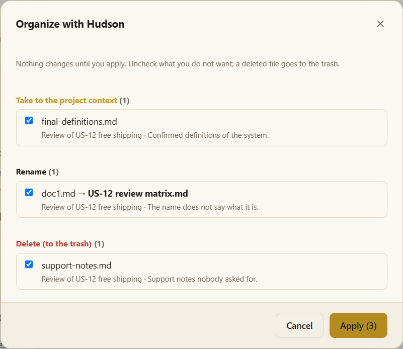

# Runs and deliverables

## Answer first, files only when they matter

Most of what you ask is answered **in the conversation**: a question, an explanation, a definition, an investigation, a small change. No file is created for that.

The AI creates a **run** — a folder under *Execution files* — only when:

- you **ask for a file**; or
- the activity's result **is a document** — a review matrix, test cases, a report, evidence, a bug; or
- the work **stops at an approval** and has to be continued later.

It never writes support documents nobody asked for (notes, summaries, plans) or logs of its own work. When one would help, it offers it in one line and waits for your yes.

## What you see in Execution files

Each run shows **what was asked** — its title — and **only its deliverables**. Its internal files (the state that lets it resume, the inputs, helper files) stay out of sight, still on disk.

The **Executions** card of the project panel lists the same work under **Requests**: each activity you started, its status, and the scenario it was about. What waits for you — an approval, an answer — comes first under **Needs you**, with a ▶ to continue it in your AI.

## Approvals and coming back

A skill stops at its approval points and asks in the terminal. If you close the app, the run keeps where it stopped: ask the AI to continue it — in the same tool or another — and it reads where it was and goes on.

## Only what you asked for

The AI delivers only the files you asked for, in the format you asked; when the format is not set, it asks. No copies in other formats, no screenshots of a spreadsheet. Helper files go to the run's `work/` folder and are cleared when the run is completed. Anything extra that still lands next to the deliverables is listed on the run's page under **Leftovers**, to send to the trash.

## Hudson organizes what runs leave behind

When files pile up, **right-click Execution files › Organize with Hudson**.

1. Your AI (Claude Code or Codex) looks at the files the runs left — never their state, inputs or journals — and proposes, **file by file with a reason**:
   - **Take to the project context** — confirmed knowledge worth keeping;
   - **Rename** — a deliverable whose name does not say what it is;
   - **Delete** — support notes, drafts, duplicates — **to the trash**;
   - **Keep** — what you asked for, or anything it is not sure about.
2. **Uncheck** what you do not want.
3. **Apply.** Moki does the moves; the AI touches nothing. A file taken to the context is listed in `context/index.md`.

Hudson is also an agent: in a terminal, ask it to organize the project and it shows the same plan as a table and waits for your approval.

## Clean on its own

- `temporary/` — anything older than **7 days** goes to the trash when the project opens.
- A finished run's `work/` folder is cleared when the project opens.

## See also

- [Calling activities, agents and skills](call.md)
- [Projects and workspaces](projects.md) — the context, where Hudson takes confirmed documents.
