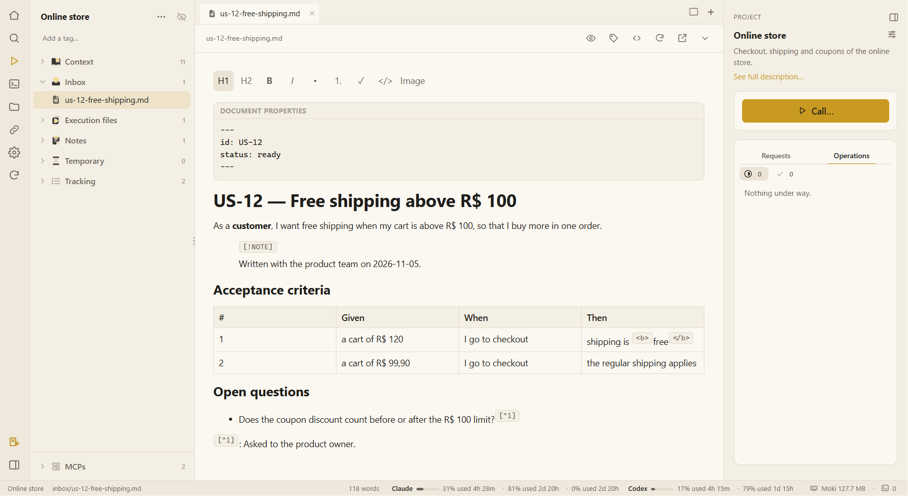

# A tour of the screen

This is what you see with a project open, from left to right.

## 1. The icon rail (far left)

| Icon | What it does |
|---|---|
| 🏠 **All projects** | Back to the start screen: projects, loose notes and the workspace. |
| 🔍 **Search** (Ctrl+Shift+F) | Looks through the workspace: project names and descriptions, and the names and text of their files. Tags work as filters. |
| ▶ **Open in your AI tool** | The same as **Call…**: choose what the AI should do. |
| `>_` **New terminal** | A terminal tab of the project: your shell or an AI tool. |
| 📁 **Open the project folder** | The project's folder in your file manager. |
| 🔗 **Link a folder** | Links a folder of your computer (the system's code, its documents) to the project; it shows live at the top of the tree. Highlighted when a folder is linked. |
| ⚙️ **Settings** | Agents, activities, your AIs, operations, skills, MCP servers and templates. See [Settings](settings.md). |
| 🔄 **Refresh** | Reads the project from disk again. |
| 🐾 **Moki in your IDE** | Opens Moki inside VS Code or Cursor, installing or updating its extension when needed. See [Moki in the IDE](ide.md). |
| 📝 **New note** (bottom) | A loose note, opened in the main area — it stays on this computer until you send it to a project. |
| ◧ (bottom) | Shows or hides the file sidebar. |

## 2. The project's files (sidebar)

The project's name with its tags, then its folders:

- **Context** — what is confirmed about the system.
- **Inbox** — what you hand to the AI. Drop files on the window to add them.
- **Execution files** — each piece of work, by what was asked, with only its deliverables.
- **Notes** — your notes.
- **Temporary** — scratch files, cleared after 7 days.
- **Tracking** — the files Moki keeps up to date: proposed updates and the activity log.
- **MCPs** (bottom) — the tools the AI gets in this project.

A **linked folder** comes first, under its own name. Right-click any item for its menu: new file or folder, rename (F2), show in the folder, copy its path or link, delete to the trash. Drag a file onto a folder to move it.

## 3. Tabs and the editor (center)

Every file opens in a tab. Every AI terminal starts its own **group** of tabs, with a name and a color, like a browser's tab groups, and the files the AI delivers open in its group. The button at the top right splits the screen into up to four views.

The bar above a document has, from left to right: the reading view (eye), tags, the Markdown source (`</>`, Ctrl+E), reload from disk, open in another program, and the file's details. See [Files and the editor](files-and-editor.md).

## 4. The project panel (right)

- The project's **name and description**; the sliders open the **project settings**.
- **Call…** — what the AI should do: activities, agents, skills and operations. See [Calling activities, agents and skills](call.md).
- **Skills and agents** — the ones this project has: its own, the global skills it links, and its defaults. A name opens its file; ▶ asks the AI to use it.
- **Executions** — *Requests* (each activity you started and where it is) and *Operations*, with what needs you on top.

The ◧ button at the top collapses the panel into a thin rail.

## 5. The status bar (bottom)

The project and the file open, its word count, how much of your AI plans you have used (for Claude and Codex, per window of time), and how much memory Moki itself uses.

## Next

➡️ [Projects and workspaces](projects.md)
