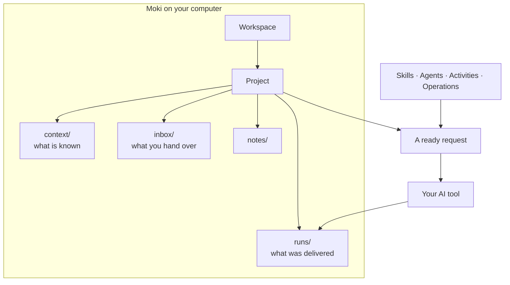

# What is Moki

Moki is a **desk for quality work with AI**. It does not bring an AI of its own: it works with the one you already use — Claude Code, Codex, Gemini, Cursor, Antigravity, or a web chat — and gives it what it needs to do QA work well: the project's context, the files, a clear request, and a procedure to follow.

Everything stays **on your computer**, in plain folders and Markdown files you can open with any program.

## The idea in one picture

*A project holds what is known and what you hand over; Moki turns your choice into a request; your AI works in the project and delivers there.*

## The words you will see

| Word | What it means |
|---|---|
| **Workspace** | A folder with its own projects, tags and settings — for example one per company or client. Projects of one workspace never see another one. |
| **Project** | One body of work: a system you test, a release, a client. It has a folder with `context/`, `inbox/`, `notes/` and `runs/`. |
| **Context** | What is *confirmed* about the system: business rules, glossary, flows, environments. The AI treats only this as known. |
| **Inbox** | The files you hand to the AI: a story, a log, a spreadsheet, a PDF. |
| **Skill** | A procedure the AI follows step by step, with its rules and approval points — for example *requirements review* or *test design*. |
| **Agent** | A role with instructions and skills — Sherlock investigates, Watson documents, Lestrade registers bugs, Hudson organizes files. |
| **Activity** | A ready-made request you pick in **Call…**: what to ask, of which skill or agent, with which files. |
| **Operation** | Several agents linked by arrows, each in its own terminal, handing work to the next. |
| **Run** | One piece of work that produced a document or waits for your approval. Its deliverables are what you see in the tree. |

## How Moki behaves

- 🏠 **Local first.** Projects live in `Documents\Moki` (or the folder you choose). Nothing is sent anywhere unless your AI tool sends it.
- 🧱 **Projects are isolated.** The AI reads the active project and only the shared files you allow through tags. See [Privacy and isolation](privacy-and-isolation.md).
- ✋ **You approve the important steps.** A skill stops at its approval points (a test plan, a bug before it is published) and waits for you.
- 💬 **Answers come in the conversation.** Questions, definitions and small changes are answered in the chat. A file is created only when you ask for one or when the activity's result is a document.
- 🗂️ **The files are the memory.** AI tools do not share a memory. A run writes where it stopped, so you can continue it tomorrow, in another tool.
- 🧭 **Nothing is invented.** Missing information becomes a question or a pending item, never a guess presented as fact.

## What Moki is not

- It is **not an AI** and does not need an account of its own: your AI tool keeps its own login and plan.
- It is **not a cloud service**: there is no server of Moki holding your projects.
- It is **not a test runner**: the AI writes and runs what the skills say; Moki prepares, shows and organizes.

## Next

➡️ [Getting started](getting-started.md) — install and create your first project.
